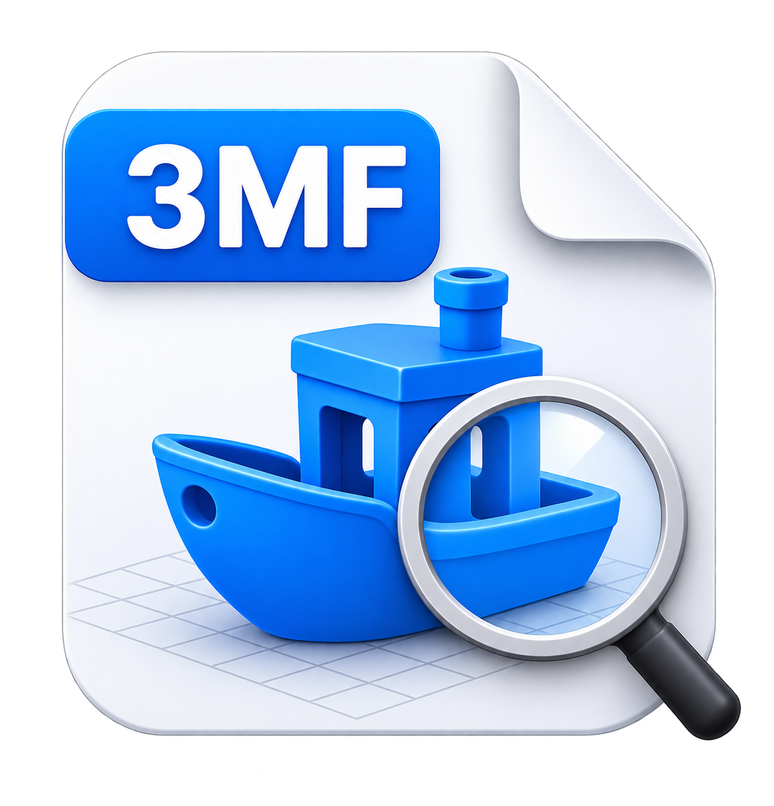
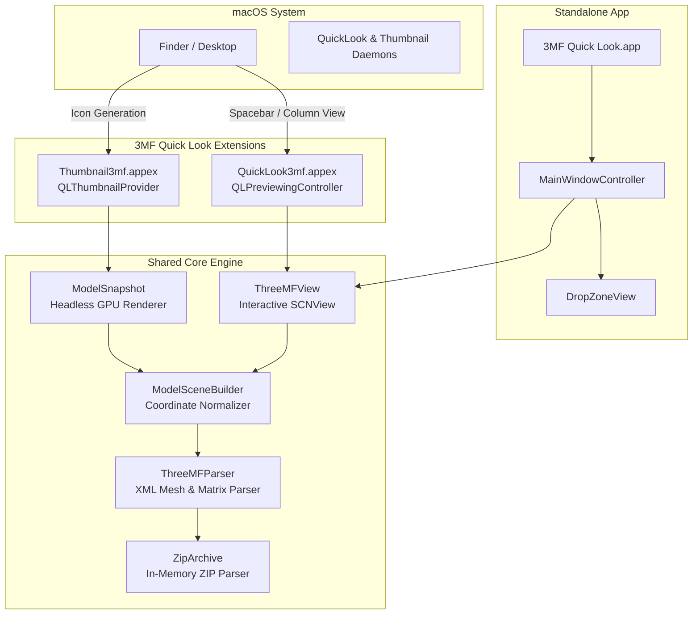

# 3MF Quick Look

[](https://apple.com)
[](https://swift.org)
[]()
[-success)]()
[]()

<p align="center">
  
</p>

A lightweight, zero-dependency macOS application and Quick Look app extension that delivers instant 3D model previews, interactive spacebar Quick Look inspection, and Finder thumbnail generation for 3D Manufacturing Format (`.3mf`) files.

---

## Overview

In 3D printing and modern additive manufacturing, the 3MF (`.3mf`) format is the industry standard for packaging meshes, multi-material data, slice information, and assemblies. However, macOS lacks native system preview support for 3MF archives. Identifying models in Finder historically required launching heavy slicing suites (Bambu Studio, PrusaSlicer, OrcaSlicer, Cura) or CAD environments, introducing friction into daily workflows.

**3MF Quick Look** solves this by integrating directly with macOS LaunchServices, QuickLook, and QuickLookThumbnailing:

- **Finder Quick Look:** Tap `Spacebar` on any `.3mf` file in Finder for an instant, interactive 3D viewport with smooth orbit, pan, and zoom.
- **Finder Column & Gallery Previews:** Real-time 3D interactive inspection embedded directly in macOS Finder navigation columns.
- **System Thumbnails:** Automatic high-resolution desktop and folder thumbnail generation across macOS.
- **Standalone Desktop Viewer:** A native, drag-and-drop 3D inspection window with wireframe visualization, metric build-plate framing, and geometry telemetry.

---

## Key Capabilities

- **Zero-Latency Finder Previews:** Direct integration via modern `QLPreviewingController` and `QLThumbnailProvider` app extensions running in isolated, sandboxed macOS system processes.
- **Pure-Swift In-Memory Archive Extraction:** Built-in streaming ZIP archive decoder and XML parser that unpacks and reconstructs 3D geometry entirely in memory without spawning external child processes (`unzip`).
- **Interactive 60 FPS 3D Viewport:** Hardware-accelerated SceneKit viewport supporting intuitive trackpad two-finger scroll panning, left-click orbital rotation, and pinch-to-zoom.
- **Metric Build-Plate & Ground Grid:** Slicer-accurate build-plate reference plane featuring 10mm minor increments, 50mm major markers, origin crosshairs, and dynamic Light/Dark mode contrast adaptation.
- **Dual-Path Thumbnail Pipeline:** Fast-path instant extraction of slicer-embedded thumbnails (`Metadata/thumbnail.png`) in sub-5ms, with an offscreen headless SceneKit GPU rasterizer fallback for files without embedded previews.
- **Geometry Telemetry:** Real-time extraction of physical bounding dimensions (width, depth, height in millimeters), total triangle counts, vertex counts, and sub-object assemblies.

---

## Technical Approach

### 1. In-Memory ZIP Streaming Without Subprocesses
Traditional macOS quicklook scripts often rely on shelling out to `/usr/bin/unzip`, introducing process invocation latency, fork overhead, and sandbox entitlement hurdles. 3MF Quick Look implements `ZipArchive`, a native Swift binary parser that reads the ZIP Central Directory structure from memory-mapped data and decompresses `3D/3dmodel.model` directly using Apple's `libcompression` deflate routines.

### 2. Coordinate System Normalization
The 3MF specification dictates a right-handed Cartesian coordinate system where $+Z$ represents the vertical build height, and all spatial units are in millimeters. Apple SceneKit adopts a $+Y$ vertical coordinate system. 

The pipeline normalizes geometry by applying an initial $-90^\circ$ rotation about the $X$-axis, evaluating the composite transformation hierarchy across nested component objects, and calculating the exact world-space axis-aligned bounding box (AABB). The entire model is then centered horizontally over the origin while clamping its lowest point to the build plate floor at $Y = 0$.

### 3. Adaptive 60 FPS Event Architecture
To prevent battery drain on MacBooks while maintaining 60 FPS responsiveness during interaction, `ThreeMFView` operates in an event-driven mode. Rather than forcing continuous GPU rendering, user gestures (trackpad pan scrolls, mouse drags, magnifications) switch the view to continuous rendering dynamically and debounce to idle (0% GPU utilization) 150ms after input cessation.

### 4. Non-Blocking Event Propagation in Finder Column Views
Finder column previews embed Quick Look views inside complex AppKit responder chains. By subclassing `SCNView`, avoiding blocking modal tracking loops (`window.nextEvent`), and configuring pass-through telemetry overlays, touch gestures and mouse drags seamlessly orbit and pan without stalling Finder's column navigation.

---

## Architecture Overview



### Component Responsibilities

| Component | Responsibility |
|---|---|
| `ZipArchive` | Memory-efficient ZIP archive navigation; decompression via `libcompression`. |
| `ThreeMFParser` | Single-pass SAX XML parsing for vertices, triangles, object hierarchies, and affine matrix transforms. |
| `ModelSceneBuilder` | Translates 3MF components into a SceneKit scene graph; normalizes $Z$-up to $Y$-up; generates lighting and build plate. |
| `ThreeMFView` | Interactive AppKit viewport; custom orbital camera controller; gesture arbitrations; adaptive rendering loop. |
| `ModelSnapshot` | Headless, off-screen renderer for embedded thumbnails and icon rasterization. |
| `PreviewViewController`| Quick Look view extension adapter managing lifecycle within macOS QuickLook host processes. |
| `ThumbnailProvider` | System thumbnail extension returning aspect-fitted bitmaps to Finder. |

---

## Tech Stack

- **Languages:** Swift 5.7+
- **UI & Graphics Frameworks:** AppKit, SceneKit, Metal, QuartzCore
- **System Extensions:** QuickLook, QuickLookThumbnailing, UniformTypeIdentifiers
- **Compression:** Apple `Compression` (`libcompression` DEFLATE)
- **Platforms:** macOS 12.0+ (Monterey, Ventura, Sonoma, Sequoia)
- **Architectures:** Universal Binary (`arm64` Apple Silicon + `x86_64` Intel)
- **Tooling:** `swiftc`, `iconutil`, `sips`, `codesign`

---

## Engineering Highlights

- **Sub-5ms Thumbnail Fast-Path:** Inspects the ZIP Central Directory for embedded slicer renders (`Metadata/thumbnail.png`). If present, the image is extracted and returned to Finder without parsing 3D geometry.
- **Optimized Rasterization:** Configures SceneKit materials with Blinn shading and hardware backface culling (`cullMode = .back`), cutting rasterized triangle workload by 50% for high-poly 3D scans.
- **Zero-Fighting Build Plate:** Ground grid geometry is elevated $0.01\text{ mm}$ above the baseplate with `writesToDepthBuffer = false` and `readsFromDepthBuffer = true`, guaranteeing zero polygon depth-fighting with models resting at $Y = 0$.
- **4-Tier Slicer Metric Grid:** Renders an intuitive visual hierarchy:
  - **Base Floor:** Charcoal slate plate providing physical grounding.
  - **Minor Lines:** Standard 10mm metric spacing.
  - **Major Lines:** Bolder 50mm inspection markers.
  - **Center Crosshairs:** High-contrast origin reference lines at $X = 0, Z = 0$.
- **Dynamic System Theme Adaptation:** Listens for `viewDidChangeEffectiveAppearance()` to smoothly update grid contrast between macOS Light Mode and Dark Mode.
- **Designated Security Requirements:** Ad-hoc codesigning with designated requirements pinned to `identifier "com.quick-look.3mf"`, ensuring TCC permissions remain intact across iterative development rebuilds.

---

## Navigation & Controls

| Input Action | Result |
|---|---|
| **Left Click + Drag** | Orbit camera around model center |
| **Two-Finger Scroll (Trackpad)** | Pan camera parallel to view plane |
| **Right Click + Drag** | Pan camera parallel to view plane |
| **Pinch Gesture (Trackpad)** | Smoothly zoom in / out |
| **Mouse Scroll Wheel** | Step zoom in / out |
| **Key `R` / Spacebar** | Reset camera framing and orientation |
| **Key `G`** | Toggle build plate ground grid visibility |
| **Key `W`** | Toggle wireframe mesh visualization |
| **`⌘O`** | Open file dialog |

---

## Building from Source

### Prerequisites

- macOS 12.0 or later
- Xcode Command Line Tools (`xcode-select --install`)

### Build Commands

```bash
# Build the application and embedded app extensions
make build

# Run the native test suite
make test

# Launch the compiled app
make run

# Package a signed, distributable macOS disk image (DMG)
make dmg

# Reset permissions and flush macOS QuickLook & LaunchServices caches
make revoke
```

---

## Future Improvements

- **Texture Mapping Support:** Add support for 3MF Material and Texture 2D extensions (`spec: materials`).
- **Multi-Bed Assembly Split:** Visual isolation for multi-part printing plates and individual build components.
- **Slicer Metadata Extraction:** Surface slicing statistics (filament weight, print duration, layer heights, and material types) directly in the preview telemetry bar.

---

## Summary

3MF Quick Look bridges the gap between modern 3D manufacturing formats and native macOS desktop ergonomics. Built with zero third-party dependencies and engineered for extreme performance, it provides 3D printing enthusiasts, designers, and engineers with effortless model inspection right from Finder.
